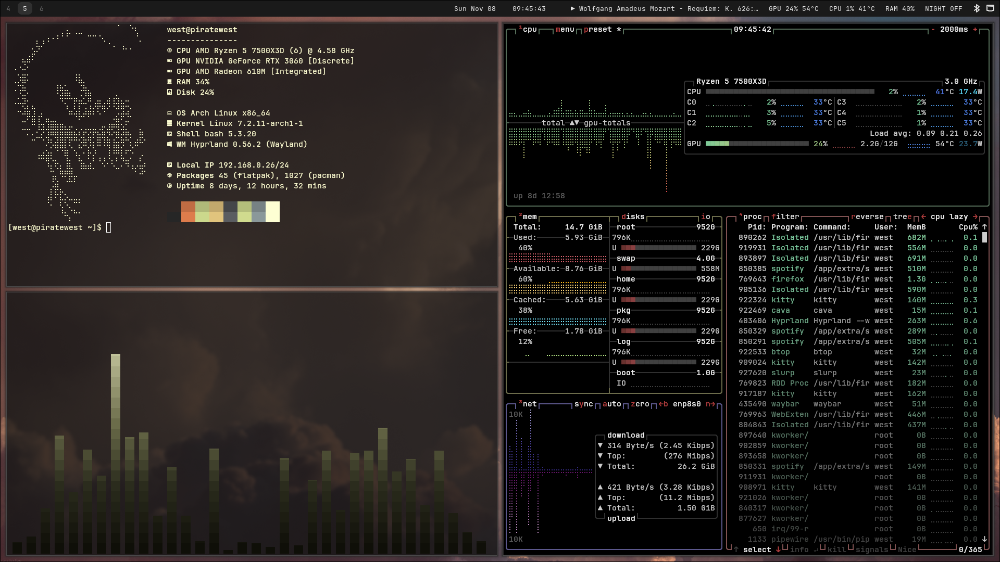

# Hyprland dotfiles

minimal Hyprland setup for Arch Linux on a desktop.

## What's included
- **Hyprland** (Lua config) with square corners and a cream active border
- **Waybar** with workspaces, clock, music, GPU, CPU, and a night light toggle
- **hyprlauncher**, **hyprlock**, **hypridle**, **hyprsunset**, **hyprpaper** + **Waypaper**
- **kitty**, **cava**, and **fastfetch**

## Requirements
- Hyprland 0.55 or newer. The config is Lua, so it will not work on older versions.
- Packages are listed in `packages-native.txt` and `packages-aur.txt`.
- A Nerd Font (I use JetBrainsMono Nerd Font).

## Change these for your setup
- **Monitors:** `hl.monitor(...)` lines in `.config/hypr/hyprland.lua` use `DP-1` (1920x1200) and `HDMI-A-1` (1920x1080). Run `hyprctl monitors` for yours.
- **NVIDIA:** the environment variables are for an RTX 3060. Remove them on AMD or Intel.
- **Wallpapers:** the folder path in `.config/waypaper/config.ini` points to my home directory.

## Keybinds

- **META + T:** Terminal
- **META + Q:** Launcher
- **META + L:** Lock screen
- **META + W:** Wallpaper picker
- **META + 1-6:** Switch workspace
- **Print:** Screenshot (region to clipboard)
- **META + F:** Exit Hyprland
- **META + C:** Open kcalc
- **META + S:** Open Spotify

## Install
Back up your config first, then copy the files you want:
    cp -r .config/hypr ~/.config/

## Credits
- fastfetch theme: [Zeibytes](https://github.com/Zeibytes/10Hour/tree/main/fastfetch)
- more themes: [FastCat](https://github.com/m3tozz/FastCat)
- Wallpapers from [wallhaven.cc](https://wallhaven.cc). [Cloud Wallpaper](https://wallhaven.cc/w/w5dgxr).
- ASCII picture conversion tool: [emojicombos.com](https://emojicombos.com/dot-art-generator) 
